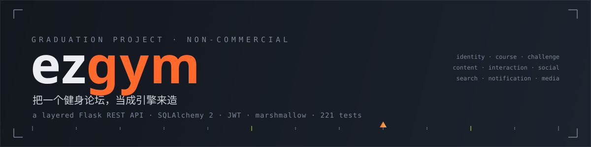
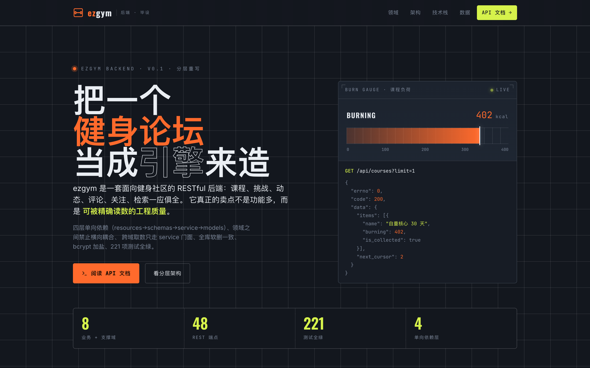
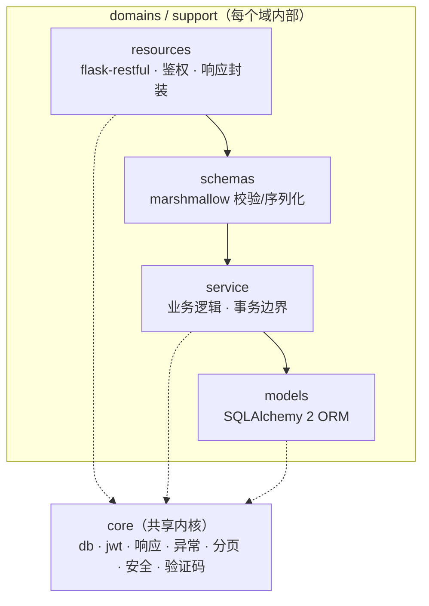
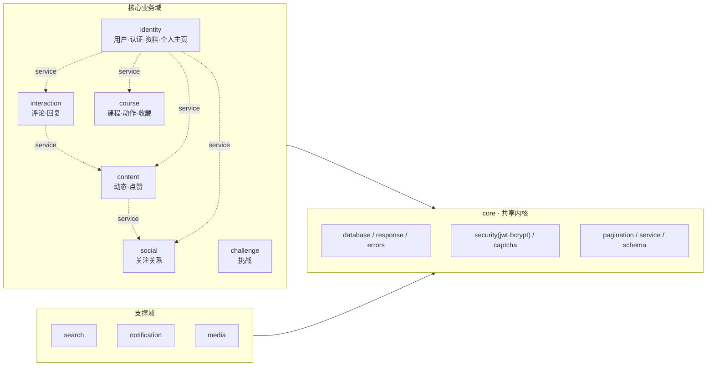
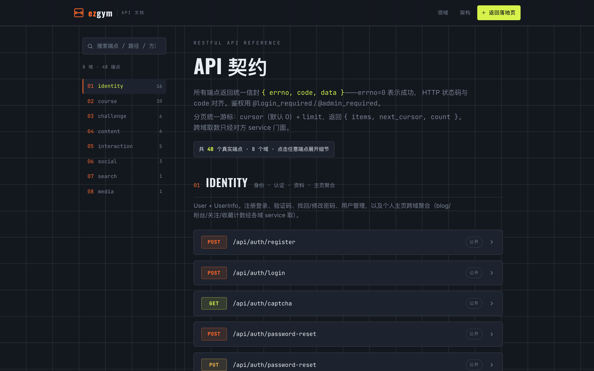
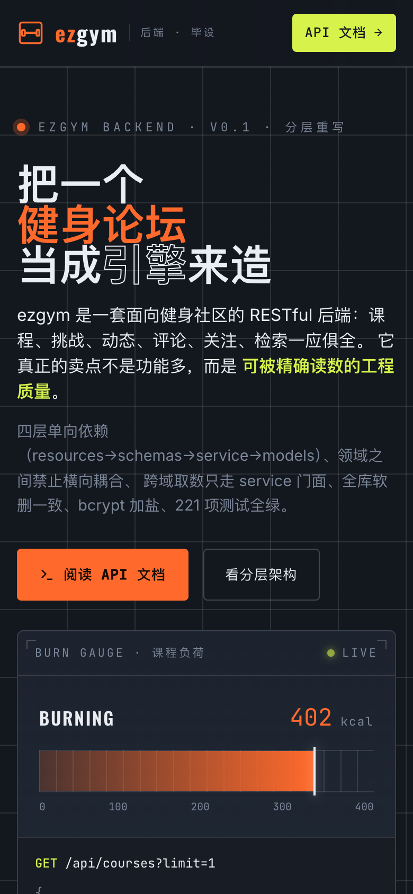
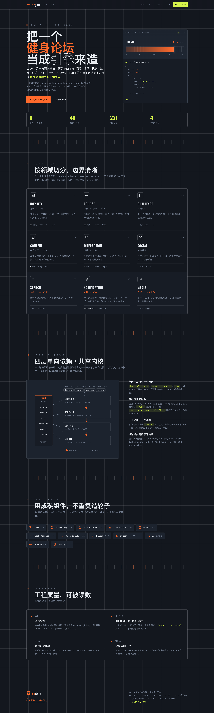

<p align="center">
  
</p>

<h1 align="center">ezgym · 健身论坛后端</h1>

<p align="center">
  一个把「健身论坛」当成引擎来造的毕业设计 —— 分层架构、组件化、测试先行的 Flask REST API。
</p>

<p align="center">
  
  
  
  
  
  
  
</p>

<p align="center">
  <b><a href="#-快速开始">快速开始</a></b> ·
  <b><a href="#-架构">架构</a></b> ·
  <b><a href="#-api-一览">API</a></b> ·
  <b><a href="#-测试">测试</a></b> ·
  <b><a href="#-展示站">展示站</a></b>
</p>

> [!NOTE]
> 本项目为**毕业设计**、**非商用**。它从一个 2019 年的老 Flask 单层原型（手写 SQL / 手写 JWT / MD5 密码 / 无测试）出发，做了一次系统性的破坏性重构：引入 ORM 与成熟组件、按领域分层、修复 28 处历史缺陷、补齐接口级 e2e 测试网，并现代化整套依赖以清除 GitHub 安全告警。

---

## ✨ 亮点

- 🧱 **领域分层，不是一堆碎文件** —— `core` 共享内核 + 6 个业务域 + 3 个支撑域，`resources → schemas → service → models` 四层单向依赖，跨域只走对方 service 门面。
- 🔧 **手写的能换的都换了** —— 连接池 + 裸 SQL → **SQLAlchemy 2**；手写 JWT（在现代 Python 直接崩溃的 bug）→ **Flask-JWT-Extended**；MD5 + 全局固定盐 → **bcrypt 每用户随机盐**；反射式校验 → **marshmallow**；手写验证码 → **captcha**；手工 `schema.sql` → **Alembic 迁移**；内存限流 → **Flask-Limiter**。
- 🐛 **28 个历史 bug 系统性根治** —— 含 6 个 Critical（登录签名崩溃、SQL 注入、连接池泄漏、建课必失败、取消关注不返回、改密吞异常），每个都有回归测试。
- 🧪 **测试先行** —— **221 个测试**，service 单测 + **接口级 e2e**（Flask test client 穿透整条栈，断言 HTTP 状态码 + `{errno,code,data}` 契约 + 真实 JWT）。
- 🔒 **安全默认** —— 机密全部走环境变量、密钥与盐分离、权限实时查库、XSS 统一转义、上传内容嗅探。
- 📦 **uv 构建** —— `pyproject.toml` + `uv.lock`，一条命令拉起环境。
- 🎨 **精美展示站** —— 纯静态落地页 + 交互式 API 文档（零构建、手绘 inline SVG）。

<p align="center">
  
</p>

---

## 🏗 架构

四层单向依赖，业务域之间禁止横向直连，跨域取数经对方 `service` 门面：



领域划分（把原来的十几个「页面式」碎目录，按真实业务边界重新合并）：



> 依赖规则由约定守护：`domains/* → core` 单向；`core` 不 import 任何域；跨域调用只允许触碰对方 **service 层**，禁止 import 他域 model。

---

## 🧩 技术栈

| 关注点 | 选型 | 取代了 |
|---|---|---|
| Web 框架 | Flask 3.1 + Flask-RESTful 0.3.10 | Flask 1.1 + flask_script（已废弃）|
| ORM / 迁移 | SQLAlchemy 2.0 · Flask-SQLAlchemy · Flask-Migrate (Alembic) | 手写连接池 + 字符串拼 SQL + 手工 `ezgym.sql` |
| 认证 | Flask-JWT-Extended 4.7 | 手写 HMAC JWT（现代 Python 崩溃 / 实为 MD5）|
| 密码 | bcrypt（每用户随机盐）| MD5 + 全局固定盐 |
| 校验 / 序列化 | marshmallow 4 | 反射式 `BaseValid` |
| 验证码 | captcha | 手写 Pillow 绘制 |
| 限流 | Flask-Limiter | 内存字典（永不回收）|
| 图像 | Pillow 12.3 | Pillow 6.2（多个 CVE）|
| 测试 | pytest（单测 + 接口级 e2e）| 无 |
| 构建 | uv | requirements.txt |

---

## 📁 项目结构

```
ezgym/
├── __init__.py          # create_app 应用工厂
├── config.py            # 环境变量驱动的配置（机密不入库）
├── extensions.py        # db / migrate / jwt / ma / limiter / cors 单例
├── cli.py               # flask init-db / flask seed
├── core/                # 共享内核：database·response·errors·security·captcha·pagination·service·schema
├── domains/
│   ├── identity/        # 用户·认证·资料·个人主页聚合·注册统计
│   ├── course/          # 课程·动作·收藏
│   ├── challenge/       # 健身挑战
│   ├── content/         # 动态(blog) + 点赞(like)
│   ├── interaction/     # 评论 + 回复
│   └── social/          # 关注关系
└── support/
    ├── search/          # 参数化全文检索
    ├── notification/    # 惰性 SMTP 邮件（找回密码）
    └── media/           # 文件上传（内容嗅探 + MD5 去重）
migrations/              # Alembic 迁移
tests/                   # pytest：service 单测 + tests/e2e 接口级 e2e
frontend/                # 纯静态展示站（落地页 + API 文档）
```

每个域内是统一的 `models.py / schemas.py / service.py / resources.py`。

---

## 🚀 快速开始

前置：[uv](https://docs.astral.sh/uv/)、Python 3.13（uv 可自动装）、MySQL 8（或用 SQLite 快速体验）。

```bash
# 1. 安装依赖（uv 自动创建虚拟环境并锁定版本）
uv sync

# 2. 配置环境变量
cp .env.example .env      # 填入 SECRET_KEY / JWT_SECRET_KEY / DATABASE_URL / MAIL_* 等

# 3. 建库 + 造种子数据（admin/admin123 + 示例课程/挑战/动态）
uv run flask --app ezgym db upgrade     # 应用 Alembic 迁移（MySQL）
uv run flask --app ezgym seed

# 4. 启动
uv run flask --app ezgym run --debug
# 服务默认在 http://127.0.0.1:5000 ，健康检查 GET /api/health
```

> 想零配置尝鲜？把 `DATABASE_URL` 设成 `sqlite:///ezgym.db`，再 `flask --app ezgym init-db && flask --app ezgym seed` 即可。

---

## 📡 API 一览

统一响应体 `{"errno": int, "code": int, "data": any}`（`errno=0` 成功），HTTP 状态码与业务码对齐。鉴权分：公开 / 软登录 / 登录 / 管理员。

| 域 | 前缀 | 说明 |
|---|---|---|
| identity | `/api/auth/*` `/api/users/*` `/api/stats/*` | 注册·登录(验证码)·改资料·改密·用户管理·个人主页聚合·注册统计 |
| course | `/api/courses/*` `/api/actions/*` `/api/collections/*` | 课程·动作·收藏 |
| challenge | `/api/challenges/*` | 挑战 · 浏览量原子自增 |
| content | `/api/blogs/*` | 动态列表(latest/following/user)·发帖·点赞（计数事务一致）|
| interaction | `/api/comments/*` `/api/replies/*` | 评论 · 楼中楼回复 |
| social | `/api/follows/*` | 关注 / 粉丝 |
| search | `/api/search` | 参数化全文检索（防注入）|
| media | `/api/files` | 图片上传（内容嗅探 + 去重）|

完整的端点、参数、鉴权、示例请求/响应见**交互式 API 文档页** `frontend/api.html`：

<p align="center">
  
</p>

---

## 🧪 测试

测试先行，覆盖 service 单测与**接口级 e2e**（用 Flask test client 打真实端点，请求穿透 `resources → schemas → service → models → SQLite`，断言 HTTP 状态码 + 响应契约 + 真实 JWT，状态自造可清、用例间隔离）。

```bash
uv run pytest -q                       # 全量 221 passed
uv run pytest tests/e2e -q             # 仅接口级 e2e
uv run pytest --cov=ezgym              # 覆盖率
```

e2e 专门为 CR 发现的每个 Critical/High 缺陷写了回归用例：JWT 签发/校验、SQL 注入被参数化挡住、连接不泄漏、建课字段完整、取消关注有返回、改密异常正确上抛、点赞计数与明细单事务一致等。

---

## 🔒 从旧版修复的问题（节选）

<details>
<summary>点击展开 CR 修复清单</summary>

| # | 严重度 | 问题 | 修复 |
|---|---|---|---|
| 1 | Critical | 手写 HMAC 漏传 digestmod，现代 Python 登录直接崩溃、旧环境实为 MD5 | 换 Flask-JWT-Extended |
| 2 | Critical | blog 搜索 `.format` 拼 SQL 注入 | ORM 绑定参数化 |
| 3 | Critical | 每个认证请求泄漏连接池连接 | SQLAlchemy 会话管理 |
| 4 | Critical | 建课 SQL 5 列 4 占位符，必失败 | ORM 建模 |
| 5 | Critical | 取消关注成功分支无 return | service + 明确响应 |
| 6 | Critical | 改密 finally 里 return 吞异常 | 异常正常上抛 |
| 10 | High | 权限取自 token 不查库，提权/降权有窗口 | `admin_required` 实时查库 |
| 12 | High | 点赞计数与明细无事务一致 | 单事务内同时维护 |
| — | Sec | 机密硬编码（DB 密码 / 邮箱授权码 / SECRET_KEY）| 全部走环境变量 |
| — | Sec | 密码 MD5 + 全局固定盐 | bcrypt 每用户随机盐 |
| — | Deps | Pillow 6.2 / Flask 1.1 等多个 CVE | 整栈现代化，清除告警 |

完整评审见提交历史与内部 CR 报告。

</details>

---

## 🎨 展示站

`frontend/` 是一套**纯静态**展示站（零构建、零 npm、手绘 inline SVG 图标），视觉母题是"测力仪表台"——配色从课程模型里真实的 `burning`（消耗卡路里）字段推导出点火暖色。直接用浏览器打开 `frontend/index.html` 与 `frontend/api.html` 即可。

<p align="center">
  
  
</p>

设计系统（color / type / layout / signature）见 [`frontend/DESIGN_NOTES.md`](frontend/DESIGN_NOTES.md)。

---

## 📝 License

毕业设计作品，**仅供学习与非商业用途**。欢迎参考架构与工程实践；如需商用请先联系作者。

<p align="center"><sub>Built as a graduation project · 把一个健身论坛，当成引擎来造</sub></p>
